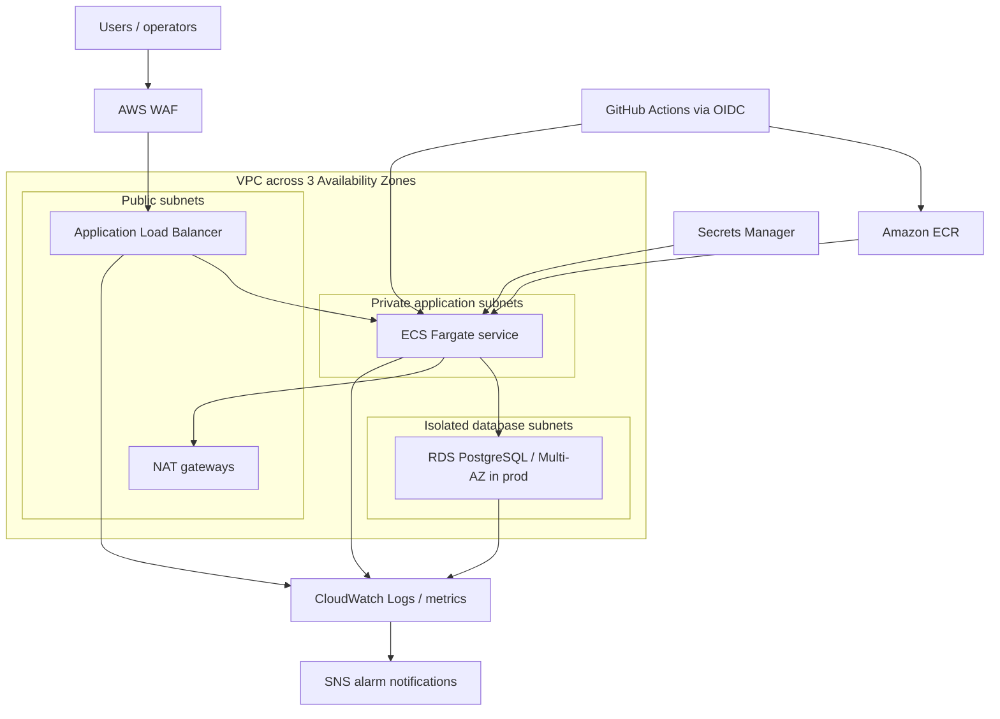

# AWS Production Platform Capstone

A production-style AWS workload designed to demonstrate the work expected from a mid-level/senior Cloud Architect, SysOps Administrator, or DevOps Engineer. The repository is deliberately more than an infrastructure demo: it includes a small service, repeatable infrastructure, deployment controls, security boundaries, monitoring, recovery procedures, and architectural decisions.

The workload is a containerized task API running on Amazon ECS with AWS Fargate. An Application Load Balancer is the only public entry point. Tasks and the PostgreSQL database run in private subnets across multiple Availability Zones.

> **Cost warning:** applying this stack creates billable resources, including NAT gateways, an ALB, RDS, WAF, and interface endpoints when enabled. Start with `dev.tfvars`, configure a billing alert, and destroy the environment after practice. Nothing in this repository deploys automatically until AWS and GitHub are explicitly configured.

## What this proves to an employer

| Target role | Evidence in this project |
|---|---|
| Solutions Architect | Multi-AZ network design, managed-service choices, threat boundaries, scaling, RTO/RPO, cost trade-offs, ADRs, Well-Architected review |
| SysOps Administrator | CloudWatch dashboards and alarms, VPC Flow Logs, backup/PITR, SSM/ECS Exec, incident runbooks, capacity and health troubleshooting |
| DevOps Engineer | Terraform, immutable images, GitHub OIDC, PR checks, environment promotion, deployment circuit breaker, image scanning, rollback workflow |

## Architecture



## Production characteristics

- Three subnet tiers; workloads and database receive no public IPs.
- Least-privilege security-group paths: internet to ALB, ALB to tasks, tasks to PostgreSQL.
- TLS listener support through ACM, regional WAF managed rules, rate limiting, encrypted storage, and secrets generated and managed by RDS.
- ECS rolling updates with a deployment circuit breaker, health checks, autoscaling, Container Insights, and ECS Exec for audited diagnostics.
- RDS encryption, automated backups, deletion protection in production, Performance Insights, and Multi-AZ failover.
- Encrypted, versioned remote Terraform state with native S3 lockfiles.
- GitHub Actions uses short-lived OIDC credentials; no AWS access keys are stored in GitHub.
- VPC Flow Logs, ALB access logs, CloudWatch alarms/dashboard, SNS notifications, and a monthly AWS Budget.

## Repository map

```text
app/                       Fastify API, tests, migration, and container image
infrastructure/bootstrap/  One-time encrypted Terraform state bucket
infrastructure/            AWS workload stack
infrastructure/environments/ dev and prod input examples
.github/workflows/         CI, Terraform plan, and controlled deployment
docs/adr/                   Architecture Decision Records
docs/runbooks/              Operator procedures
docs/                       threat model, SLO, DR, cost, and learning plan
scripts/                    Local verification helpers
```

## Quick start (local)

Prerequisites: Node.js 22+, Docker, Terraform 1.10+, and AWS CLI v2 for cloud deployment.

```bash
make install
make validate
make docker-build
docker run --rm -p 3000:3000 cloudops-api:local
curl http://localhost:3000/health/live
```

The service can run without a database for local smoke testing. Set `DB_REQUIRED=true` and the `DB_*` variables to exercise PostgreSQL readiness and the task API.

## AWS deployment path

1. Read [deployment.md](docs/deployment.md), [cost-management.md](docs/cost-management.md), and the ADRs.
2. Authenticate with an administrator/bootstrap role using AWS IAM Identity Center. Do not create a long-lived IAM user key.
3. Create the remote state bucket from `infrastructure/bootstrap`.
4. Copy the appropriate backend example to `infrastructure/backend.hcl` and replace its placeholders.
5. Run a reviewed Terraform plan with the development variables.
6. Build and push the first image, then apply the workload stack.
7. Configure the GitHub environment and OIDC role before enabling automated deployments.
8. Execute the verification and failure-injection exercises in [learning-path.md](docs/learning-path.md).

Detailed commands and the first-image bootstrapping sequence are in [deployment.md](docs/deployment.md).

## Engineering objectives

| Objective | Target |
|---|---|
| Availability | 99.9% monthly for the production API |
| Recovery point objective | 15 minutes |
| Recovery time objective | 60 minutes for in-region restore; 4 hours for regional rebuild |
| Deployment | No static AWS credentials; reviewed plan; immutable image digest |
| Security | Private compute/data, encryption in transit and at rest, managed edge controls |
| Operations | Actionable alarms, dashboard, logs, documented rollback and restore |

## Deliberate trade-offs

This is a strong single-workload baseline, not a claim of infinite scale. A real organization should place production, non-production, security, and log archive workloads in separate AWS accounts under AWS Organizations. Cross-Region warm standby, centralized Security Hub/GuardDuty, AWS Config aggregation, and organization-wide CloudTrail belong in the platform or security accounts and are documented as extensions rather than silently simulated inside one account.

Start with the [learning path](docs/learning-path.md) and keep an evidence folder of screenshots, plans, dashboards, incident notes, and cost reports. Those artifacts turn the repository into an interview story.

The design baseline and current-service assumptions are linked in [primary references](docs/references.md).
